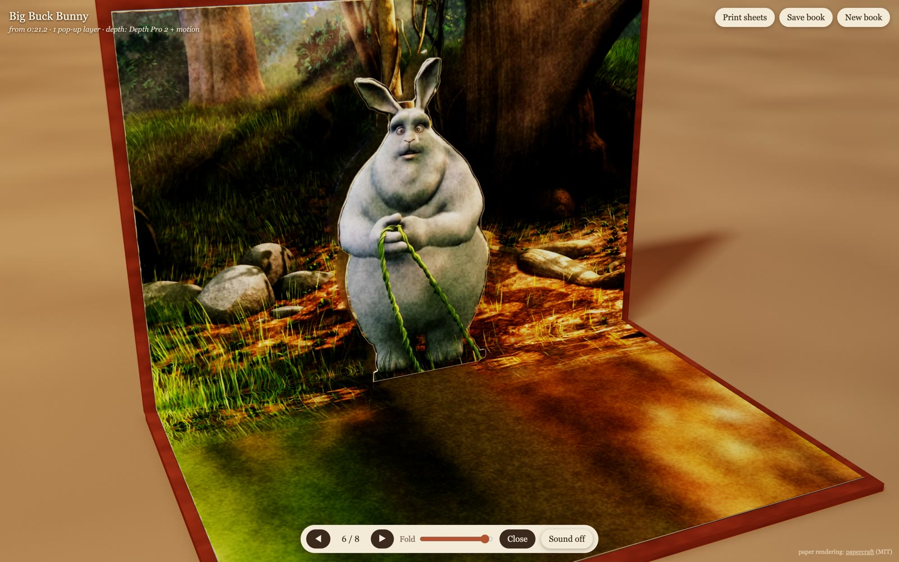
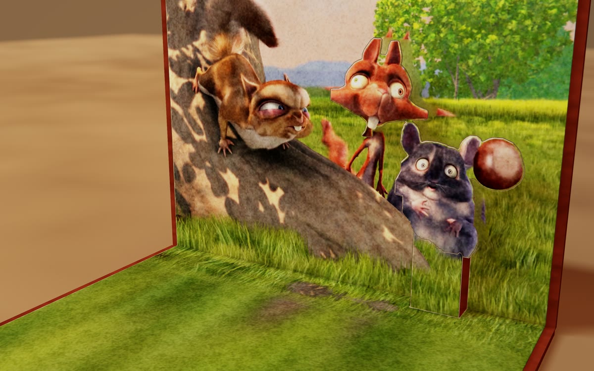
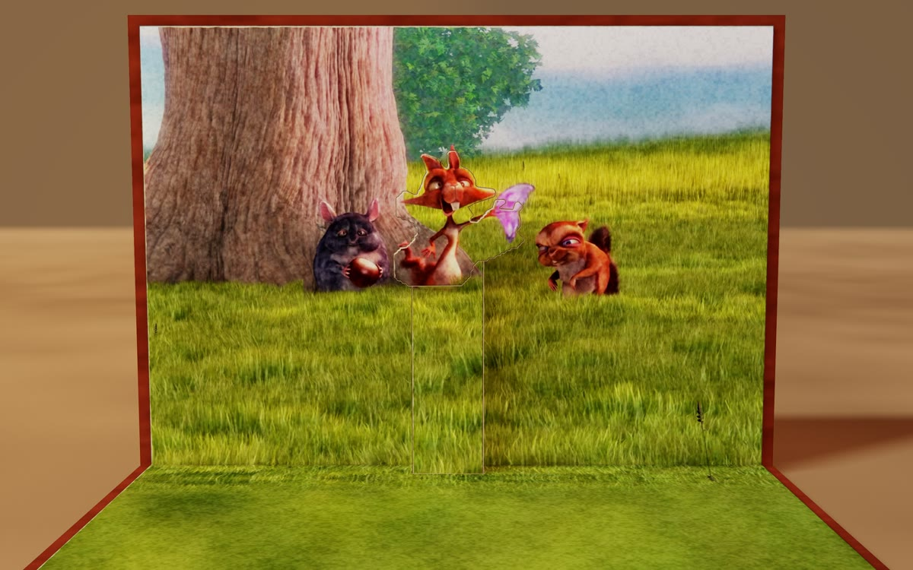
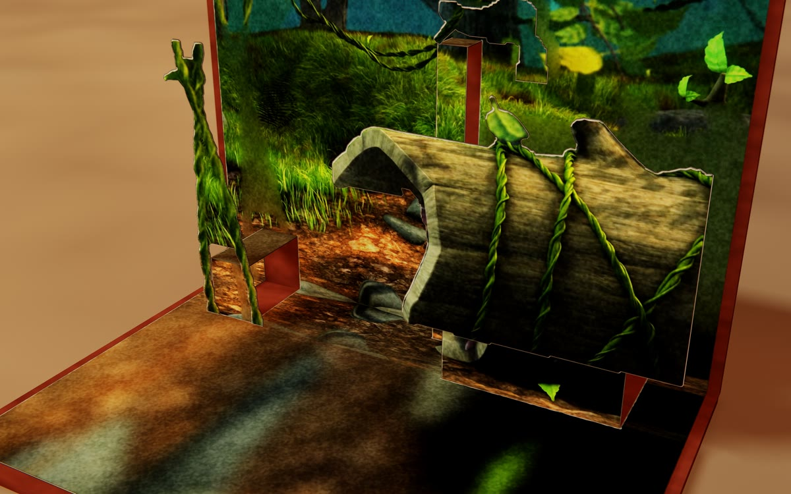
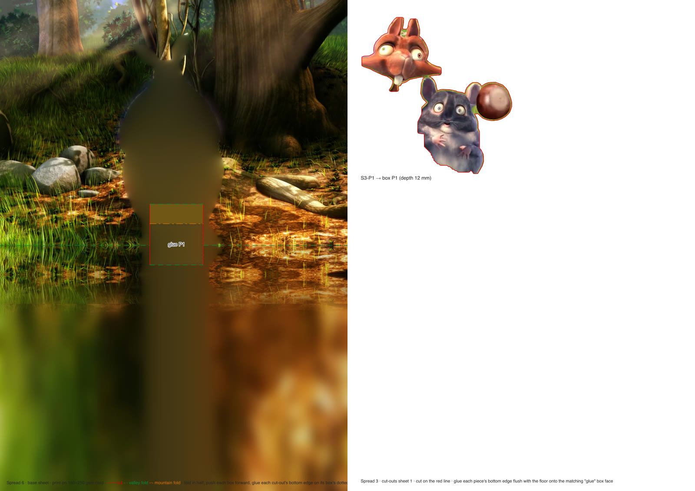

# PopUpStory

Turn a short video into a pop-up book: a 3D papercraft book you can flip through in the browser, and printable A4
sheets to cut, fold and glue into the real thing.

**[Try it in your browser →](https://donpark.github.io/popupstory/)** It opens on a demo book; *New book* makes
your own from a short video.



| | | |
|---|---|---|
|  |  |  |
| Cut-outs stand at their own depths | Head-on, a spread reproduces its shot | Any shot with figures on the ground works |



*Print, cut, fold: a base sheet per spread (backdrop, floor, slits, folds, glue marks) and cut-out sheets.*

- **Web app** (`web/`): drop a video and it builds the book in your browser. Decoding uses a `<video>` element,
  analysis and paper engineering run in the Rust core compiled to WebAssembly, and rendering uses three.js with
  [papercraft](https://github.com/xikhar/papercraft)'s paper kit. Nothing is uploaded; a 10 s clip takes ~5 s.
- **CLI** (`src/main.rs`): the same core, with ffmpeg for decoding. It writes `book.json` plus the SVG sheets.

```
# web app
wasm-pack build --target web --release --no-default-features --out-dir web/pkg
python3 -m http.server -d web 8000          # open http://localhost:8000

# CLI (needs ffmpeg on PATH)
cargo run --release -- movie.mp4 -o my-book --spreads 6     # binary: popupstory
#   my-book/sheets/*.svg   print: one base sheet + cut-out sheet(s) per spread
#   my-book/book.json      drop it on the web app (or serve it and open ?book=path/to/book.json)
```

## How it works (no AI by default)

| Stage | Method |
|---|---|
| Spreads | shot detection (colour-histogram jumps + frame-difference spikes) → longest wide shots (close-ups skipped) → sharpest frame in each |
| Depth | heuristic nearness (motion, focus, colour saliency, position), or a depth model |
| Objects | figure/ground map (how much nearer than its image row, a rough ground plane) → one region per object, kept whole at its median depth; split only where its depths form clearly separate groups |
| Clean edges | with a full-resolution depth map, each mask snaps to depth edges (no halo of grass round a head) |
| Paper engineering | 90° box folds whose depth places a cut-out and whose height lifts it back to where it was in the frame, so head-on a spread reproduces its shot; folds flat (`depth + elevation + height ≤ page`); folds never overlap; notches where a deeper box passes through a shallower piece; anything too tall to fold flat stays in the backdrop |
| Backdrop | the sharp keyframe with every cut-out filled out of it (push-pull pyramid fill) so nothing appears twice; same for nearer cut-outs inside farther ones |
| Print | A4 SVG: backdrop on the top half, ground on the floor half, slits, valley / mountain folds, glue marks; box faces printed with the backdrop they hide; cut-outs with bleed out to the cut line |
| Player | papercraft's `makeCard` turns each cut line + image into a card with thickness and a printed cut edge, plus matte paper shading, PCSS shadows, a tilt-shift lens and the latched flap spring for opening and closing |

The player uses the same kinematics as the paper. At opening angle θ every box strip is a parallelogram, so each
face stays parallel to the back page or the floor, and a spread that folds flat on screen folds flat in card.

## The demo book

The preloaded book is built from `web/samples/big-buck-bunny-montage.mp4`, eight wide shots from Big Buck Bunny
(© Blender Foundation, CC BY 3.0), with depth from Apple's Depth Pro 2 (H+) run locally, as a non-commercial demo.
`scripts/build-demo.sh` rebuilds it. Books made in the browser use the heuristic or Depth Anything V2 small.

## Optional: a depth model (the "minimal AI" switch)

The heuristic depth is the weak link. Real depth makes the figure/ground split much better: tree and mound come
forward instead of foreground grass.

- **Web:** tick *Use a depth model*. It runs Depth Anything V2 small via transformers.js, on WebGPU when available.
  The ~25 MB download happens once, then about a second per spread on the device.
- **CLI:** any local model, once per keyframe:
  ```
  popupstory movie.mp4 --depth-cmd 'python run_depth.py {in} {out}' --depth-far-is-bright
  popupstory movie.mp4 --depth-dir depth/      # precomputed spread_01.png… (white = near)
  ```
  `--depth-far-is-bright` handles metric/distance output, e.g. Apple Depth Pro 2 in metres, converted to inverse
  depth. Check model licences: Depth Pro 2's weights are research / non-commercial.

## Agent skills

Two [Agent Skills](https://agentskills.io) ship with the repo (Claude Code, Codex, Cursor, Gemini CLI, …):

- **`popupstory`**: working on this codebase: the pipeline, units and coordinates, `book.json`, the folding
  invariants, adding mechanisms, and verification.
- **`papercraft-3d`**: general engineering for 3D papercraft and pop-up worlds: fold kinematics (box, stacked,
  floating, V-fold maths), flat-foldability checks, photo → card conversion, paperkit tips, plus lessons from
  [Papertrails](https://xikhar.github.io/papertrails/) and a design for a PopUpStory roguelike. It pairs with
  [xikhar/papercraft](https://github.com/xikhar/papercraft), which covers the look.

```
npx skills add donpark/popupstory
```

## Layout

```
src/lib.rs        core (no I/O): analysis, layers, layout, render, book (plan → analyze → render_spread)
src/wasm.rs       wasm-bindgen Session for the browser
src/main.rs       CLI (+ src/video.rs ffmpeg wrapper)
web/              index.html, app.js (pipeline), player.js (papercraft book), vendor/papercraft (MIT, see COMMIT)
tests/            end-to-end check that generated books obey the folding rules
skills/           agent skills: popupstory, papercraft-3d
```

## Credits

Paper rendering uses [papercraft](https://github.com/xikhar/papercraft) by xikhar (MIT). Sample video: Big Buck Bunny,
© Blender Foundation, CC BY 3.0. See [THIRD_PARTY.md](THIRD_PARTY.md). PopUpStory itself is MIT licensed.

## Roadmap

- **Share:** an embeddable player and a vertical clip of the book unfolding (Shorts / Reels), for creators.
- **Gallery:** creators publish pop-up versions of their own videos (YouTube sign-in to prove ownership), with a
  link back to the original video.
- **Desktop app:** Tauri around the same web UI with the Rust core running natively. Fully offline, reads any format
  via ffmpeg, and supports larger depth models.
- **Step inside:** an immersive mode where a spread opens into a walkable paper scene, in the spirit of
  [Papertrails](https://xikhar.github.io/papertrails/).

## Known limits

- Without a depth model, layers are much rougher: masks are blurry and objects are missed or merged.
- The close-up detector and the "longest shots" choice are heuristics: on a whole film they can still pick a
  close-up or a credits card. Curating shots (as for the demo) gives far better books.
- The fill behind cut-outs is a smooth blur, invisible head-on but visible from steep angles and on the print.
- Objects that float in the frame get glued to the floor.
- 90° box folds only. 180° spreads need V-folds or floating layers on supports.
- The cut-out sheets don't nest pieces tightly (shelf packing).
